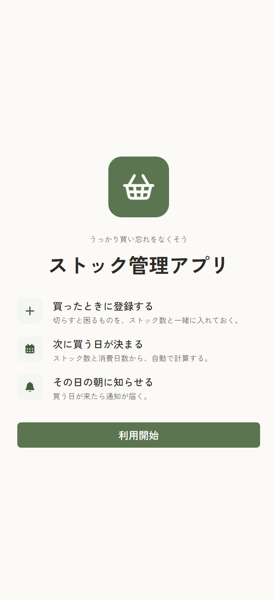
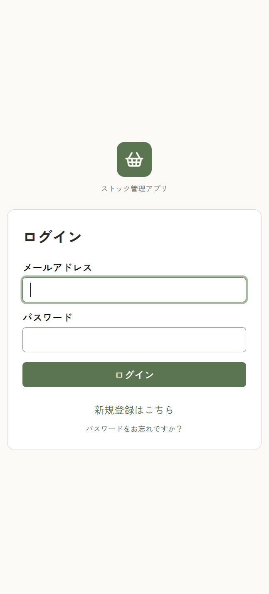
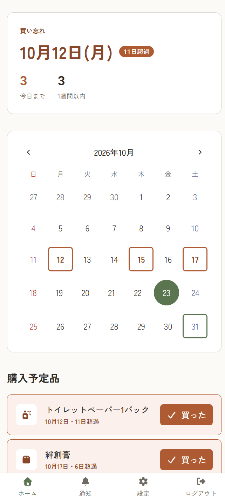
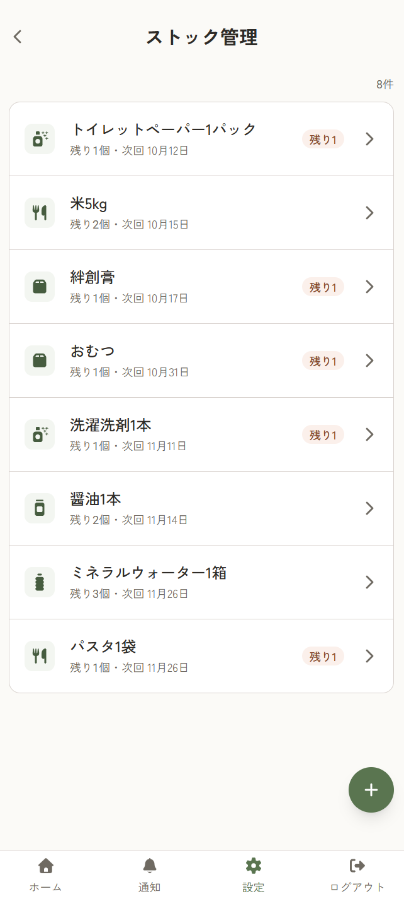
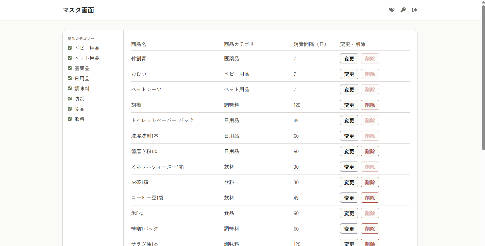
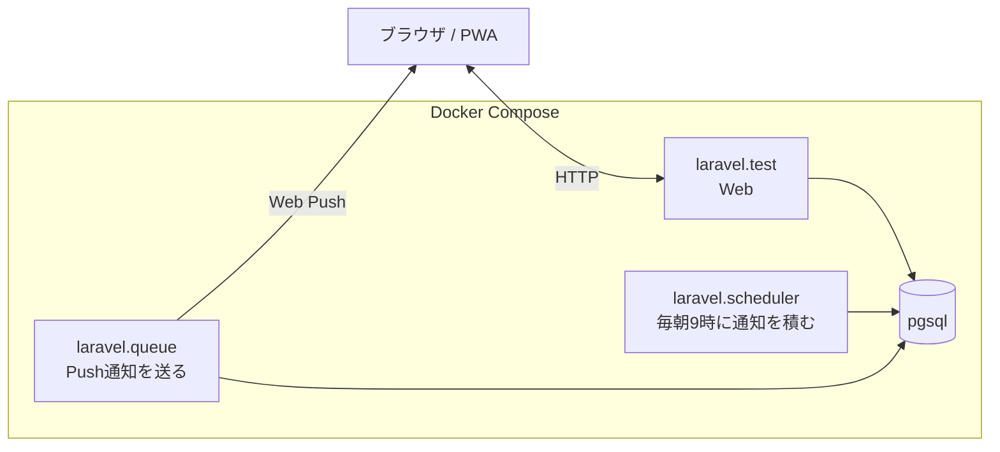

# ストック管理システム

食品や日用品のストックを管理し、買い忘れを防ぐWebアプリケーションである。

- **どんなアプリか**：夫婦や同居人のいる世帯向けのストック管理アプリ
- **何ができるか**：商品ごとに消費日数とストック数を登録すると、次回購入予定日を自動で割り出し、当日の朝にPush通知で知らせる
- **アピールポイント**：スマホのホーム画面に追加して使えるPWA。予定日を過ぎても、買うまで毎朝通知し続ける

## 画面

| 1. トップ | 2. ログイン | 3. ダッシュボード | 4. ストック管理 |
|:---:|:---:|:---:|:---:|
|  |  |  |  |

5. 管理者用マスタ画面



## 使用技術

| 層 | 採用 |
|---|---|
| サーバ | PHP 8.4、Laravel 13 |
| 画面 | React 19、TypeScript、Inertia 3、Tailwind CSS 4 |
| DB | PostgreSQL 18 |
| 認証 | Laravel Fortify |
| 開発環境 | Laravel Sail（Docker） |

## コンテナ構成



## 機能一覧

- **ストック管理**：商品ごとに消費日数とストック数を登録する。消費日数の初期値は世帯人数から決まる
- **ダッシュボード**：購入予定日をカレンダーと一覧で出す。購入ボタンで次回購入予定日を進める
- **Push通知**：毎朝9時に、購入予定日を迎えたものを知らせる
- **管理画面**：商品マスタとカテゴリのCRUD

## 非機能一覧

- **テスト**：Pest、Vitest
- **静的解析**：PHPStan（level 7）、ESLint、TypeScript
- **CI**：GitHub Actions で静的解析とテストを実行する

## 本番環境

Fly.io の東京リージョンで動かしている（https://stock-reminder.fly.dev/ ）。
構成と決めた理由は [計画書](doc/plans/20261018-deploy-flyio.md) にある。

### DB の復元

バックアップは毎朝4時に Tigris へ送り、30日分を残す。
コマンドは scheduler のマシンで実行する（`fly status -a stock-reminder` でマシンの ID が分かる）。

```bash
# バックアップの一覧
fly ssh console -a stock-reminder --machine <scheduler の ID> -C "php artisan app:restore-database"

# 本番の DB を置き換える（確認が出る）
fly ssh console -a stock-reminder --machine <scheduler の ID> --pty -C "php artisan app:restore-database 20261024-223620.dump"
```

`--database=<名前>` を付けると、先に作っておいた別のデータベースへ戻せる。
本番を置き換える前に中身を確かめたいときに使う。

## ドキュメント

- [要件定義書](AGENTS.md)
- [基本設計書](doc/design/README.md)
- [計画書](doc/plans/)：設計を決めた理由と、採らなかった案

## 素材の帰属

| 素材 | 出所 | ライセンス |
|---|---|---|
| 画面内のアイコン | [Font Awesome Free](https://fontawesome.com/) 7 | アイコンは CC BY 4.0、コードは MIT |
| PWAアイコンと favicon | [lucide](https://lucide.dev/) の `shopping-basket` を改変 | ISC |
| 和文書体 | [Zen 角ゴシック New](https://fonts.google.com/specimen/Zen+Kaku+Gothic+New) | SIL OFL 1.1 |
| 欧文書体 | [Roboto](https://fonts.google.com/specimen/Roboto) | SIL OFL 1.1 |
