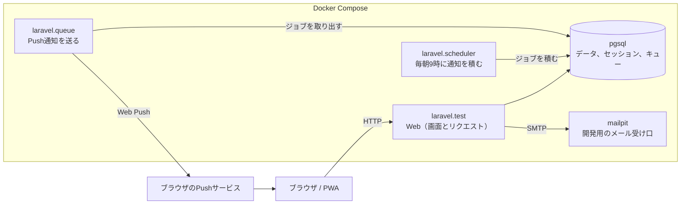

# ストック管理システム

保存のきく食品や日用品のストックを管理し、買い忘れを防ぐWebアプリケーションである。

- **どんなアプリか**：夫婦や同居人のいる世帯向けのストック管理アプリ
- **何ができるか**：商品ごとに消費日数とストック数を登録すると、次回購入予定日を自動で割り出し、当日の朝にPush通知で知らせる
- **アピールポイント**：スマホのホーム画面に追加して使えるPWA。予定日を過ぎても、買うまで毎朝通知し続ける

## 画面

| 1. トップ | 2. ログイン | 3. ダッシュボード | 4. ストック管理 |
|:---:|:---:|:---:|:---:|
|  |  |  |  |

5. 管理者用マスタ画面


## 使用技術

| 層 | 採用 |
|---|---|
| サーバ | PHP 8.4、Laravel 13 |
| 画面 | React 19、TypeScript、Inertia 3、Tailwind CSS 4 |
| DB | PostgreSQL 18 |
| 認証 | Laravel Fortify のセッション認証（一般ユーザーと管理者で別のガード） |
| Push通知 | Web Push（`laravel-notification-channels/webpush`） |
| 開発環境 | Laravel Sail（Docker） |

## コンテナ構成

Laravel Sail（Docker Compose）で5つのコンテナを動かす。デプロイ先は未定である。



| コンテナ | 役割 |
|---|---|
| `laravel.test` | 画面の表示とリクエストの処理。仮パスワードのメールもここから送る |
| `laravel.scheduler` | `schedule:work` で毎朝9時に購入日の通知をキューへ積む |
| `laravel.queue` | `queue:work` でPush通知を送る。止まっていると通知が届かない |
| `pgsql` | PostgreSQL。データのほか、セッション、キャッシュ、キューも持つ |
| `mailpit` | 開発用のメールサーバ。送ったメールを http://localhost:8025 で読む |

## 機能一覧

### 一般ユーザー

- **ストック管理**：商品ごとに消費日数とストック数を登録する。消費日数の初期値は世帯人数から決まる
- **ダッシュボード**：カレンダーに購入予定日を出し、1週間以内に予定日が来るものを一覧にする。購入ボタンで次回購入予定日を進める
- **Push通知**：毎朝9時に、当日が購入予定日のものを知らせる。予定日を過ぎたものにも送り続ける
- **通知履歴**：未読の通知を一覧にする
- **アカウント**：登録、ログイン、個人情報の変更、パスワード再設定

### 管理者

- 商品マスタとカテゴリのCRUD（使用中のものは削除できない）
- 管理者パスワードの変更

## 非機能一覧

- **PWA**：一般ユーザーの画面（`/app/*`）のみ。オフラインではオフライン用の画面を出す
- **ログ**：APIリクエストとエラーを記録する
- **テスト**：Pest 4（Unit 3ファイル、Feature 13ファイル）と Vitest 5（10ファイル）、合わせて214件
- **静的解析と整形**：ESLint、Prettier、`tsc --noEmit`、Pint、PHPStan（level 7）

## 動かし方

Docker が要る。ホストに PHP と Node は要らない。

```bash
git clone https://github.com/YUTOKONISHI/stock-reminder.git
cd stock-reminder
cp .env.example .env
docker run --rm -v "$(pwd)":/opt -w /opt laravelsail/php84-composer:latest \
    composer install --ignore-platform-reqs
./vendor/bin/sail up -d
./vendor/bin/sail artisan key:generate
./vendor/bin/sail artisan migrate --seed
./vendor/bin/sail npm install
./vendor/bin/sail npm run build
./vendor/bin/sail artisan webpush:vapid   # Push通知を試すとき
```

| URL | 用途 |
|---|---|
| http://localhost | 一般ユーザー（`test@example.com` / `password`） |
| http://localhost/admin/login | 管理者（`admin` / `password`） |
| http://localhost:8025 | Mailpit（パスワード再設定のメールが届く） |

アカウントは `migrate --seed` で入るローカル専用のものである。
検証は `./vendor/bin/sail composer ci:check` でまとめて実行する。

## ドキュメント

- [AGENTS.md](AGENTS.md)：要件定義書と開発ルール
- [doc/design/](doc/design/README.md)：基本設計書
- [doc/plans/](doc/plans/)：計画書（設計を決めた理由と、採らなかった案）

## 素材の帰属

| 素材 | 出所 | ライセンス |
|---|---|---|
| 画面内のアイコン | [Font Awesome Free](https://fontawesome.com/) 7 | アイコンは CC BY 4.0、コードは MIT |
| PWAアイコンと favicon | [lucide](https://lucide.dev/) の `shopping-basket` を改変 | ISC |
| 和文書体 | [Zen 角ゴシック New](https://fonts.google.com/specimen/Zen+Kaku+Gothic+New) | SIL OFL 1.1 |
| 欧文書体 | [Roboto](https://fonts.google.com/specimen/Roboto) | SIL OFL 1.1 |

Font Awesome Free のアイコンは CC BY 4.0 のため表示義務があり、本表がその表示にあたる。
